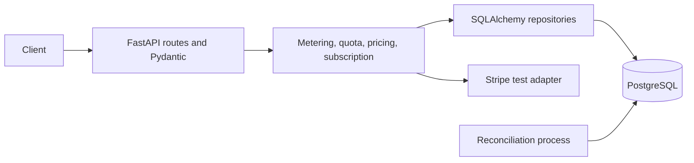

# Design

## Problem and Scope

Meter API calls and simulated AI tokens for SaaS tenants, enforce UTC-month limits, and calculate deterministic cost. Exactly two plans: Free (1,000 API calls; 100,000 AI tokens) and Pro (100,000 API calls; 10,000,000 AI tokens). No overages or real payments.

## Layers and Data

Routes handle HTTP and validation; services own rules and transactions; repositories own tenant-filtered SQL; Stripe SDK and signature code are isolated in an adapter. Alembic owns schema changes.

Tables: `tenants`; `plans`; one-per-tenant `subscriptions`; `metering_requests` unique on `(tenant_id, idempotency_key)` with request hash and stored response; `usage_events` with controlled type, positive integer quantity, UTC timestamp and integer microcent cost; and `stripe_events` unique on Stripe event ID. Foreign keys, composite tenant/request ownership, check constraints, and indexes enforce critical invariants.

## API

`GET /health`; `POST /generate` (tenant and idempotency headers plus simulated token counts); `GET /usage` (current-month tenant usage, limits, plan/status and cost); `POST /checkout` (Pro test Checkout); `POST /webhooks/stripe` (verified subscription projection). Tenant identity is a documented local `X-Tenant-ID`, not authentication. Unknown tenants are `404`; payment-state blocks are `402`; quota excess is `429`; input validation is `422`.

## Idempotency and Quota

One transaction locks the tenant row with `SELECT FOR UPDATE`, checks the tenant-scoped key/hash, reads monthly usage, checks both limits, inserts one API-call event and optionally one token event, and stores the deterministic response. Database uniqueness is the final duplicate guarantee. Same key/body returns the stored response; changed body returns `409`; same key across tenants is independent. Failed quota checks roll back. Exactly-at-limit is allowed; the next positive increment is rejected.

## Pricing and Stripe

Integer microcent rates: API call 1,000; fresh input token 300; cached input token 30; output token 1,500. Cost is `calls*1000 + (input-cached)*300 + cached*30 + (output+reasoning)*1500`. Stripe accepts test keys only. Raw webhook bytes are signature-verified before writes; event insertion and subscription update are atomic and event-ID unique. Checkout completion upgrades to Pro; verified subscription updates/deletions synchronize state. Unknown Stripe IDs do not change a tenant.

## Worker and Validation

A standalone Compose worker checks current usage against plan limits and subscription mapping/tenant-reference consistency, logs anomalies, retries transient database errors three times with exponential backoff, and records exhausted failures. Pytest/HTTPX covers pricing, boundaries, idempotency/concurrency, tenant isolation, constraints, Checkout parameters, webhook signatures/deduplication, worker retries, and API validation.

## Explicit Non-Goal

No invoicing, proration, real payment processing, or overage billing.
