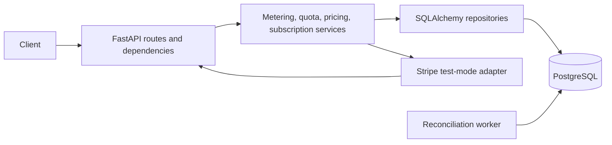

# Usage Metering and Billing Engine

A small multi-tenant FastAPI service that meters API calls and simulated AI tokens, enforces monthly plan limits, and calculates usage cost without floating-point money arithmetic. Stripe is integrated in test mode only; this project does not charge cards or issue invoices.

## Plans

| Plan | API calls per UTC month | AI tokens per UTC month |
| --- | ---: | ---: |
| Free | 1,000 | 100,000 |
| Pro | 100,000 | 10,000,000 |

Usage may reach a limit exactly. The next positive request that would exceed it is rejected with `429 quota_exceeded`; rejected requests write no metering request or usage event. A canceled Stripe Pro subscription falls back to Free limits. A non-active paid subscription returns `402 payment_required`.

## Architecture



HTTP routes parse and validate requests. Services enforce billing rules and transaction boundaries. Repositories own tenant-filtered SQL. Alembic owns schema changes. Stripe operations are isolated in `app/integrations/stripe_adapter.py`; they do not run in the metering path.

## Technology

Python 3.12, FastAPI, Pydantic, SQLAlchemy 2, PostgreSQL 16, Alembic, pytest, HTTPX, Docker Compose, and the Stripe Python SDK.

## Data Model

- `tenants`: local tenant IDs and timestamps.
- `plans`: exactly Free and Pro with their monthly limits.
- `subscriptions`: one current plan/status per tenant and optional Stripe customer/subscription IDs and period dates.
- `metering_requests`: canonical request hash and stored result, unique per `(tenant_id, idempotency_key)`.
- `usage_events`: positive integer API-call or AI-token quantities, UTC timestamp, integer cost, request reference, and JSONB pricing details.
- `stripe_events`: unique Stripe event ID and processing timestamp for durable webhook deduplication.

Foreign keys, check constraints, tenant-scoped uniqueness, and indexes protect important invariants. A composite foreign key prevents a usage event from pointing to another tenant's metering request. PostgreSQL stores integer cost in microcents; $1 = 100,000,000 microcents. Monthly summaries round half-up to integer cents only for display.

## Tenant Identity

For local evaluation, every tenant-facing route requires `X-Tenant-ID`. The ID is resolved to a known tenant; it is not authentication and must not be used as an Internet-facing identity system. Seeded IDs:

- Free: `11111111-1111-4111-8111-111111111111`
- Pro: `22222222-2222-4222-8222-222222222222`

All usage, subscription, and cost queries filter by the resolved tenant. Changing a tenant ID selects only that tenant's records; unknown IDs return `404`.

## Idempotency and Quotas

`POST /generate` requires `Idempotency-Key`. The service locks the tenant row with PostgreSQL `SELECT FOR UPDATE`, checks for an existing `(tenant, key)`, reads that tenant's current UTC-month totals, checks both quotas, and inserts the stored response and usage events in one transaction. The unique database constraint remains the final duplicate-key guarantee. Concurrent retries serialize on the tenant row. A matching retry returns the original response without additional usage; using the same key with a different body returns `409 idempotency_conflict`. The same key is independent across tenants.

One accepted call records one `api_calls` event and, when token quantity is positive, one `ai_tokens` event. Token quota quantity is `input_tokens + output_tokens + reasoning_tokens`; cached input is a subset of input and is not counted twice. A zero-token `/generate` request still consumes one API call.

## Cost Calculation

Pricing is pinned in `app/core/pricing_config.py`, not fetched live:

| Component | Rate |
| --- | ---: |
| API call | 1,000 microcents per call |
| Fresh input token | 300 microcents per token |
| Cached input token | 30 microcents per token |
| Output token | 1,500 microcents per token |

Fresh input is `input_tokens - cached_input_tokens`. Reasoning tokens are added to output tokens. The formula is:

```text
api_calls * 1,000
+ fresh_input * 300
+ cached_input * 30
+ (output_tokens + reasoning_tokens) * 1,500
```

All intermediate amounts and stored event costs are integers. The pricing test for 1 API call, 1,000 input tokens (400 cached), 100 output tokens, and 50 reasoning tokens is exactly `418,000` microcents. Cost is not a real provider quote.

## API

Interactive Swagger UI: <http://localhost:8000/docs>

| Method | Path | Purpose |
| --- | --- | --- |
| `GET` | `/health` | Liveness probe |
| `POST` | `/generate` | Validate, price, quota-check, and meter simulated token use plus one API call |
| `GET` | `/usage` | Current UTC-month tenant usage, limits, plan, status, and cost |
| `POST` | `/checkout` | Create a Stripe test-mode Checkout session for Pro |
| `POST` | `/webhooks/stripe` | Verify and process supported Stripe events |

Business errors use `{ "error": { "code", "message", "context" } }`. Validation errors return `422`; quota is `429`; inactive paid subscriptions are `402`; idempotency conflicts are `409`; invalid webhook signatures/payloads are `400`. Unknown tenants return `404`.

`POST /generate` returns the logical `request_id`, tenant, API calls and AI tokens added, integer total cost in microcents, and currency. `GET /usage` returns the tenant, UTC period bounds, current plan and subscription status, both used/limit pairs, and the summed monthly cost in cents. For example:

```json
{
	"tenant_id": "11111111-1111-4111-8111-111111111111",
	"period_start": "2026-09-01T00:00:00Z",
	"period_end": "2026-10-01T00:00:00Z",
	"current_plan": "Free",
	"subscription_status": "active",
	"api_calls_used": 1,
	"api_call_limit": 1000,
	"ai_tokens_used": 1150,
	"ai_token_limit": 100000,
	"monthly_cost_cents": 0,
	"currency": "USD"
}
```

Example request:

```powershell
$headers = @{
	"X-Tenant-ID" = "11111111-1111-4111-8111-111111111111"
	"Idempotency-Key" = "demo-generate-001"
}
$body = @{
	input_tokens = 1000
	cached_input_tokens = 400
	output_tokens = 100
	reasoning_tokens = 50
} | ConvertTo-Json
Invoke-RestMethod -Method Post -Uri http://localhost:8000/generate -Headers $headers -ContentType "application/json" -Body $body
Invoke-RestMethod -Uri http://localhost:8000/usage -Headers @{ "X-Tenant-ID" = $headers["X-Tenant-ID"] }
```

Repeat the POST with the same headers and body to receive the same logical response. Reuse the key with a changed body to get `409`.

## Stripe Test Flow

Only secret keys beginning with `sk_test_` are accepted. The Price ID must be a recurring **test-mode** Stripe Pro price; no live key is accepted, and no real payments are processed. Stripe is payment truth. The local subscription changes only after a verified Checkout/subscription event.

1. Create a recurring Pro price in the Stripe Dashboard's test mode.
2. Put the test secret key and Price ID into the local `.env` (`STRIPE_SECRET_KEY`, `STRIPE_PRO_PRICE_ID`). Never commit `.env`.
3. Forward webhook events locally and copy the CLI's printed signing secret into `.env` as `STRIPE_WEBHOOK_SECRET`:

	 ```powershell
	 stripe login
	 stripe listen --forward-to localhost:8000/webhooks/stripe
	 ```

4. Restart the API after changing `.env`: `docker compose up -d --force-recreate api`.
5. Call `POST /checkout` with a Free tenant's `X-Tenant-ID`, open the returned `checkout_url`, and complete Checkout using Stripe's test card `4242 4242 4242 4242` with any future expiry and any CVC. Stripe sends the signed event to the local API; `GET /usage` then reports Pro.

For a forwarding smoke test, `stripe trigger customer.subscription.updated` sends a CLI fixture. Unknown Stripe IDs are deliberately ignored and logged; use the real local Checkout flow to test tenant mapping. The webhook verifies the exact raw request bytes and rejects invalid signatures before database writes. `checkout.session.completed`, `customer.subscription.updated`, and `customer.subscription.deleted` are deduplicated in PostgreSQL by Stripe event ID.

Automated tests use a mock for the outbound Checkout network call and a real locally-generated HMAC signature for webhook verification. They do not claim to have completed a live Stripe-network Checkout session.

## Background Reconciliation

Compose starts a separate worker after the API is healthy. It checks current monthly plan limits, partial Stripe ID mappings, and tenant/request ownership inconsistencies; it logs pass/failure/anomaly details without mutating payment state. Transient database `OperationalError`s retry up to three times with exponential backoff (1s, 2s by default); exhausted retries are logged and raised. The loop interval defaults to 300 seconds and is configurable with `RECONCILIATION_INTERVAL_SECONDS`.

Inspect it with `docker compose logs -f worker`. Run one manual cycle with `docker compose run --rm api python -c "from app.jobs.reconcile import reconcile_once; print(reconcile_once())"`.

## Local Setup

Prerequisites: Docker Desktop with Compose and the Stripe CLI only when testing Stripe manually.

```powershell
Copy-Item .env.example .env
docker compose up --build -d
docker compose ps
```

The API waits for PostgreSQL health, applies Alembic migrations, runs the idempotent demo seeder, and starts Uvicorn. The worker waits for the API healthcheck. Open <http://localhost:8000/docs>.

Useful commands:

```powershell
docker compose run --rm api alembic upgrade head
docker compose run --rm api python -m app.seed
docker compose run --rm --volume "$($PWD.Path):/app" api pytest -q
docker compose logs -f api
docker compose logs -f worker
```

Tests use a separate `usage_metering_test` database and drop/recreate only that test schema. The seeded `usage_metering` database is not used by the test fixture.

## Environment Variables

| Variable | Purpose |
| --- | --- |
| `DATABASE_URL` | PostgreSQL URL; Compose supplies the internal `db` host |
| `TEST_DATABASE_URL` | Isolated PostgreSQL test database URL |
| `STRIPE_SECRET_KEY` | Stripe test secret (`sk_test_...` only) |
| `STRIPE_WEBHOOK_SECRET` | Signing secret printed by `stripe listen` |
| `STRIPE_PRO_PRICE_ID` | Recurring Pro test-mode Price ID |
| `STRIPE_SUCCESS_URL` | Local Checkout success redirect |
| `STRIPE_CANCEL_URL` | Local Checkout cancel redirect |
| `API_PORT` | Host port published for the API (default `8000`) |
| `RECONCILIATION_INTERVAL_SECONDS` | Worker interval (default `300`) |

`.env.example` contains only placeholders. `.gitignore` excludes `.env` and local Python/build outputs.

## Limitations

Tenant IDs are a local evaluation mechanism, not authentication. AI usage is simulated and does not call a model. Pricing is illustrative and pinned. This service does not invoice, prorate, charge real money, or bill overages. A real deployment would need an authenticated tenant identity and a production security review.
